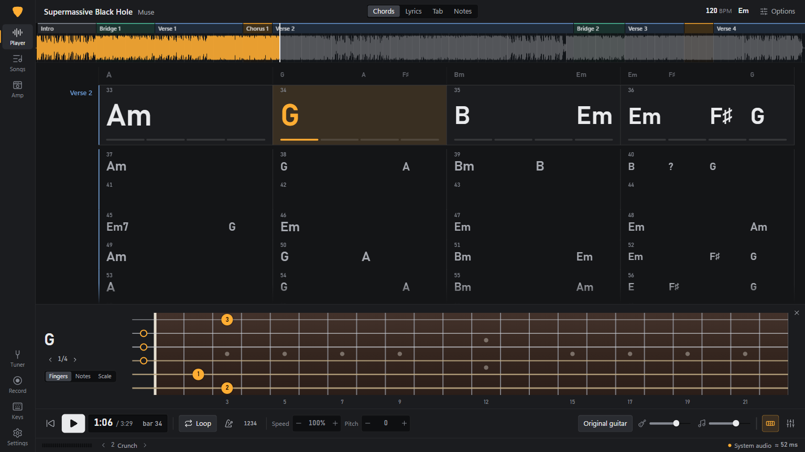
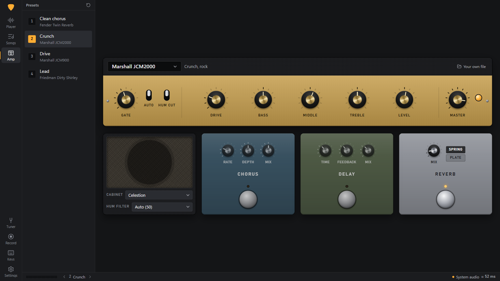
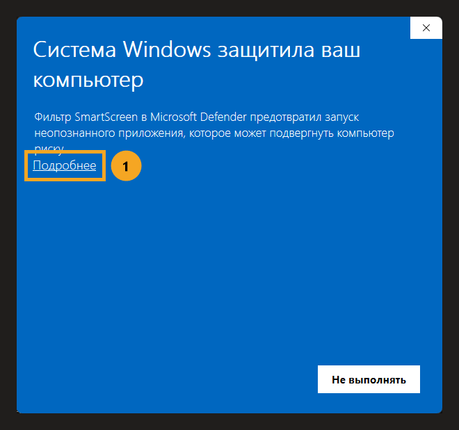
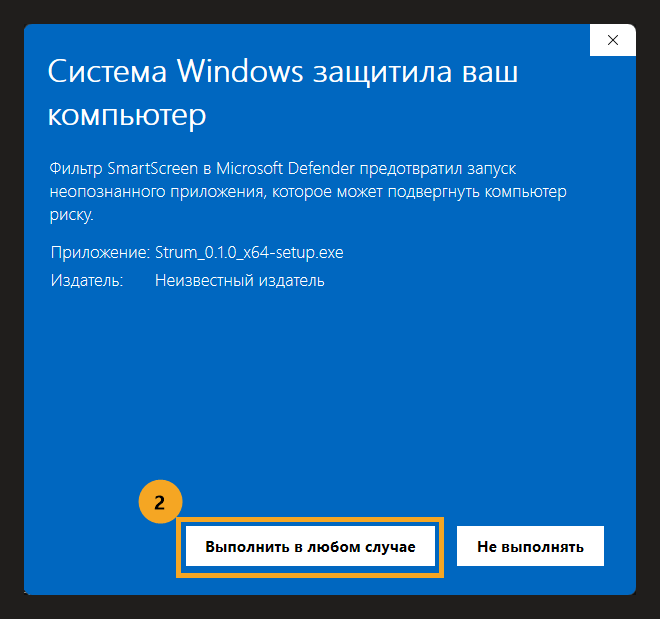

# Strum

Play your guitar through amp models with the songs you love — without their guitarist.

[Русский](README.ru.md)

The program itself speaks English, Russian, Spanish, Portuguese, German, French, Japanese and Chinese: Settings → Language.



- **Amp.** Plug the guitar into an audio interface and play through captures of real amps (Fender, Marshall, Vox, Peavey, Friedman…) with cabinets, a noise gate that finds your noise floor itself, a hum filter, chorus, delay and reverb. Four presets, a pedal on PageUp / PageDown.
- **Songs without the guitarist.** Drop an mp3 or flac: Strum separates it into vocals, drums, bass, guitar, keys and the rest, and you play the guitar part. Slow it down, change the key, loop a part, export a backing track.
- **Chords, tabs, lyrics.** Bars, chords and the key are found in the recording. Guitar Pro and MusicXML tabs and lyrics with chords follow the song. A Guitar Pro file alone becomes a song Strum plays itself, drums and bass included.
- **Practice.** The notes of the recorded guitar on the fretboard, solo phrases, "repeat after me", a speed trainer, a set list, recording your own playing.



Everything runs on your computer. Nothing is uploaded; the internet is used only to download the program's parts and, when you press the button, to look for lyrics.

## Download

Windows 10 or 11, 64-bit: **[Strum installer](../../releases/latest)** (`Strum_<version>_x64-setup.exe`).

The installer is not signed yet, so Windows warns about it:

1. The browser may say the file is not commonly downloaded: choose **Keep**.
2. On start, "Windows protected your PC": click **More info**, then **Run anyway**. The buttons are in the same places in every language:

    

3. With Smart App Control turned on, Windows blocks unsigned programs entirely. It can be turned off in Windows Security → App & browser control → Smart App Control.

The installer needs no administrator rights: Strum goes into your user folder.

## First start

1. Strum downloads Python and its base packages (about 150 MB, a minute or two). The amp, the tuner and tabs work right after.
2. Song separation is a separate download, only when you want it: on the Songs screen press **Download**. It takes about 3 GB with an NVIDIA graphics card (GTX 16xx, RTX or newer, driver 580+) and about 0.5 GB without one, and the screen shows how much is left. Songs you add before that wait for it.
3. The words model (2.9 GB, to place lyrics in time from the vocals) downloads only when you ask for it.

Separating a song takes under a minute with an NVIDIA card and a few minutes without.

## Help

- [Getting started](docs/getting-started.md): plug in the guitar, set the level, add a song, play.
- [Troubleshooting](docs/troubleshooting.md): no sound, delay, crackles, installing.
- [Report a bug](../../issues/new/choose), in English or Russian.
- [Privacy](docs/privacy.md): Strum collects nothing and goes online only in the cases listed there.

## What you need

- An audio interface with an ASIO driver (most have one) for low latency. Without ASIO Strum plays the guitar through Windows audio, with more delay.
- 8 GB of memory or more.
- Headphones or monitors on the interface.

## Where your things are

- Songs, recordings, settings and your own amp files: `Strum` in your user folder (`C:\Users\<you>\Strum`). Uninstalling never touches it. Not in Documents on purpose: Documents is often synced to OneDrive, which would upload gigabytes of separated songs.
- Python, the downloaded models and logs: `%LOCALAPPDATA%\app.strum`. The uninstaller removes it when you tick "Delete the application data".

## Building from source

You need Node.js 24, [uv](https://docs.astral.sh/uv/) and, for the installer, Rust 1.90+ with the MSVC toolchain.

```
npm install          # packages, the amp sounds and the song service (several GB with the neural networks)
npm run dev          # the app in the browser (http://localhost:5173) with the song service and the guitar engine
npm test             # frontend tests
npm run test:service # service tests
npm run build:app    # Strum.exe and the installer in shell/target/release/bundle/nsis
```

## Code signing policy

Free code signing provided by [SignPath.io](https://about.signpath.io/), certificate by [SignPath Foundation](https://signpath.org/).

- Committers and reviewers: [the project's author](../../../)
- Approvers: [the project's author](../../../)

Every installer is built from this repository's source by [GitHub Actions](.github/workflows/build.yml), and every signing request is approved by hand. What Strum sends over the internet, and when: [Privacy](docs/privacy.md).

## License

Strum is free software under the [GNU GPL v3](LICENSE). The amp captures it ships are GPL v3 as well. Everything it is built on is listed in [LICENSES.txt](LICENSES.txt).
