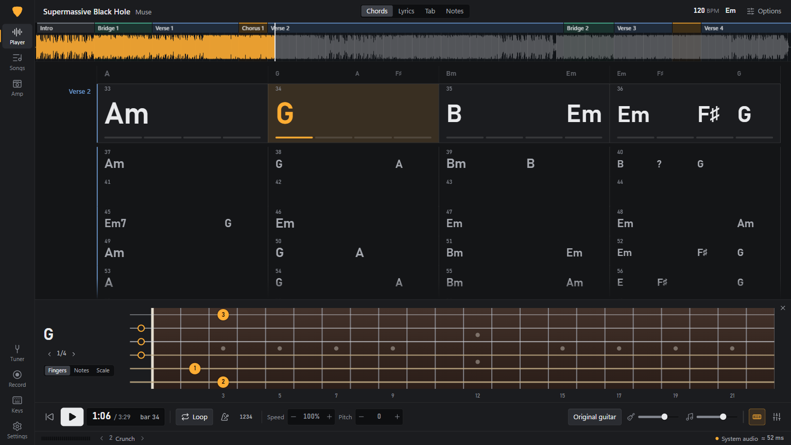
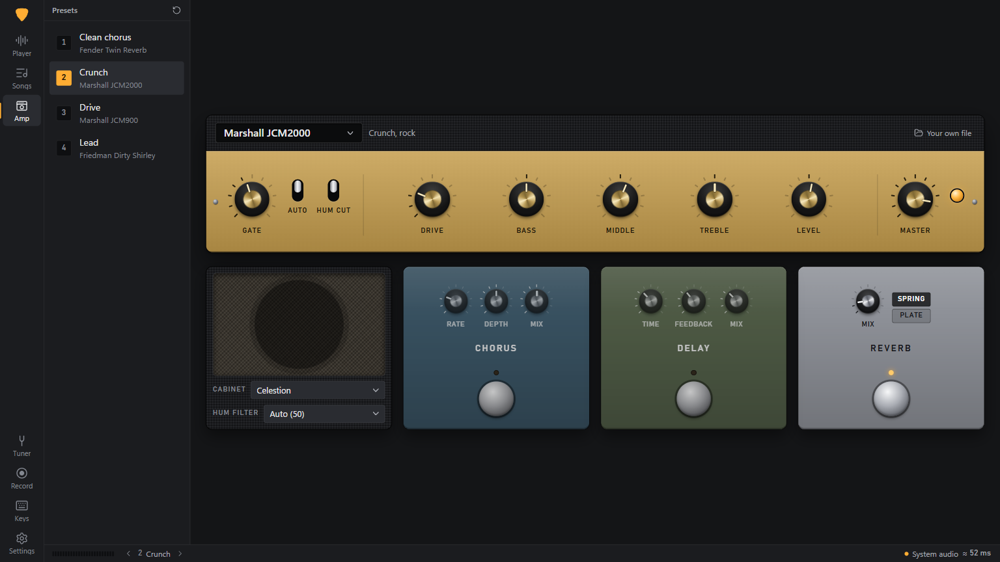
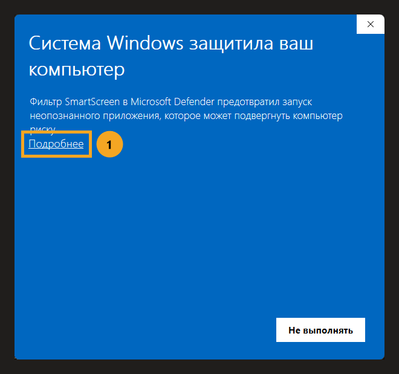
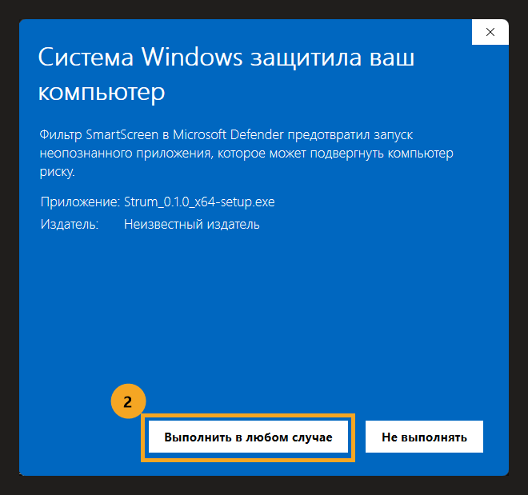

# Strum

Играй на гитаре через модели настоящих комбиков под любимые песни — без их гитариста.

[English](README.md)

Сама программа говорит по-русски, по-английски, по-испански, по-португальски, по-немецки, по-французски, по-японски и по-китайски: Настройки → Язык.



- **Комбик.** Гитара в звуковую карту — и играешь через снимки настоящих усилителей (Fender, Marshall, Vox, Peavey, Friedman…) с кабинетами, шумодавом, который сам находит уровень шума, фильтром гула, хорусом, эхом и ревером. Четыре пресета, педаль на PageUp / PageDown.
- **Песни без гитариста.** Перетащи mp3 или flac: Strum разделит песню на вокал, барабаны, бас, гитару, клавиши и остальное, а гитару играешь ты. Замедлить, сдвинуть тон, зациклить кусок, сохранить минусовку.
- **Аккорды, табы, текст.** Такты, аккорды и тональность находятся по записи. Табы Guitar Pro и MusicXML и текст с аккордами идут вместе с песней. Один файл Guitar Pro становится песней, которую Strum играет сам, с барабанами и басом.
- **Занятия.** Ноты гитары из записи на грифе, фразы соло, «Повтори за мной», разгон, сет-лист, запись своей игры.



Всё работает на твоём компьютере. Ничего никуда не отправляется: интернет нужен только чтобы скачать части программы и, по кнопке, найти текст песни.

## Скачать

Windows 10 или 11, 64 бита: **[установщик Strum](../../releases/latest)** (`Strum_<версия>_x64-setup.exe`).

Установщик пока без подписи, поэтому Windows предупреждает:

1. Браузер может написать, что файл скачивают редко: выбери **Сохранить**.
2. При запуске «Система Windows защитила ваш компьютер»: нажми **Подробнее**, потом **Выполнить в любом случае**.

    

3. Если включён «Интеллектуальный контроль приложений», Windows не запускает неподписанные программы вовсе. Его можно выключить: «Безопасность Windows» → «Управление приложениями и браузером» → «Интеллектуальный контроль приложений».

Права администратора не нужны: Strum ставится в папку пользователя.

## Первый запуск

1. Strum скачивает Python и основные пакеты (около 150 МБ, минута-две). Комбик, тюнер и табы работают сразу после этого.
2. Разделение песен скачивается отдельно и только когда захочешь: на экране «Песни» кнопка **Скачать**. Это около 3 ГБ с видеокартой NVIDIA (GTX 16xx, RTX и новее, драйвер 580+) и около 0,5 ГБ без неё, на экране видно, сколько осталось. Песни, добавленные раньше, подождут.
3. Модель слов (2,9 ГБ: ставит текст по времени по вокалу) скачивается, только когда попросишь.

С видеокартой NVIDIA песня делится меньше чем за минуту, без неё — за несколько минут.

## Помощь

- [Первые шаги](docs/getting-started.ru.md): подключить гитару, настроить уровень, добавить песню, играть.
- [Если не работает](docs/troubleshooting.ru.md): нет звука, задержка, треск, установка.
- [Сообщить об ошибке](../../issues/new/choose) — по-русски или по-английски.
- [Приватность](docs/privacy.ru.md): Strum ничего не собирает, а в интернет выходит только в случаях из этого списка.

## Что нужно

- Звуковая карта с драйвером ASIO (он есть почти у всех) — для малой задержки. Без ASIO гитара идёт через звук Windows, с задержкой больше.
- 8 ГБ памяти или больше.
- Наушники или мониторы, подключённые к карте.

## Где что лежит

- Песни, записи, настройки и свои файлы комбиков — папка `Strum` в папке пользователя (`C:\Users\<имя>\Strum`). Удаление программы её не трогает. Не в «Документах» нарочно: их часто синхронизирует OneDrive, и туда уехали бы гигабайты разделённых песен.
- Python, скачанные модели и журналы — `%LOCALAPPDATA%\app.strum`. Удаляются вместе с программой, если отметить «Удалить данные приложения».

## Сборка из исходников

Нужны Node.js 24, [uv](https://docs.astral.sh/uv/) и для установщика Rust 1.90+ с MSVC.

```
npm install          # пакеты, звуки комбиков и сервис песен (несколько ГБ с нейросетями)
npm run dev          # программа в браузере (http://localhost:5173) с сервисом песен и движком гитары
npm test             # тесты интерфейса
npm run test:service # тесты сервиса
npm run build:app    # Strum.exe и установщик в shell/target/release/bundle/nsis
```

## Code signing policy

Бесплатную подпись кода даёт [SignPath.io](https://about.signpath.io/), сертификат — [SignPath Foundation](https://signpath.org/) (Free code signing provided by SignPath.io, certificate by SignPath Foundation).

- Пишет и проверяет код (committers and reviewers): [автор проекта](../../../)
- Одобряет подпись (approvers): [автор проекта](../../../)

Каждый установщик собирается из кода этого репозитория на [GitHub Actions](.github/workflows/build.yml), и каждую подпись одобряют вручную. Что Strum отправляет в интернет и когда: [Приватность](docs/privacy.ru.md).

## Лицензия

Strum — свободная программа под [GNU GPL v3](LICENSE). Снимки комбиков в ней тоже под GPL v3. Всё, на чём она построена, — в [LICENSES.txt](LICENSES.txt).
